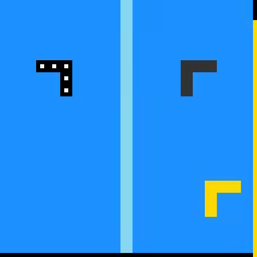
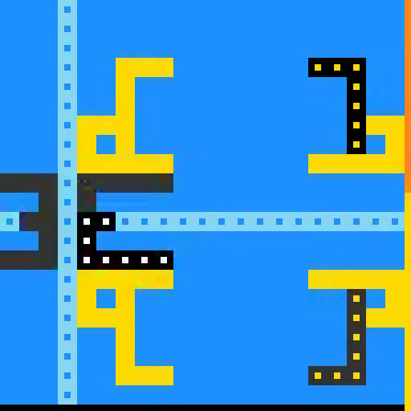
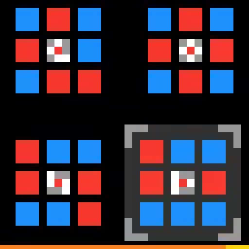
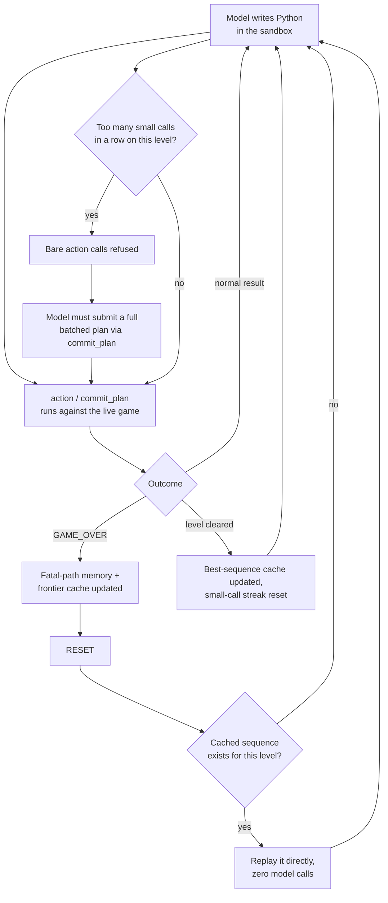

# 🧩 tabula-rasa

[Read the technical paper](other-projects/cascade-patch-v2/PAPER.md) · [PDF](other-projects/cascade-patch-v2/paper.pdf) · [Evidence and reproduction](other-projects/cascade-patch-v2/REPRODUCIBILITY.md)


<div align="center">

### My entry for [ARC Prize 2026 · ARC-AGI-3](https://www.kaggle.com/competitions/arc-prize-2026-arc-agi-3) — a Kaggle competition for genuine reasoning

An LLM agent that learns to play never-seen interactive puzzles: no training data, no memorized solutions, just a grid, five unlabeled actions, and a puzzle it's never seen before. Built, measured, and rebuilt in the open.

[-brightgreen.svg?logo=pytest&logoColor=white)]()
[]()
[](LICENSE)

</div>

---

This repo tracks the competition, not one agent — the current solver (`arcduck2`, in `src/`) is the second full rewrite and won't be the last. *Tabula rasa*: every game starts as a blank slate, nothing assumed, everything learned from observation — which is both what the agent has to do each game, and how this project has been built: ship an experiment, read what the data actually says, adjust.

## What is ARC-AGI-3?

[ARC Prize 2026 · ARC-AGI-3](https://www.kaggle.com/competitions/arc-prize-2026-arc-agi-3) is François Chollet's benchmark for testing reasoning rather than memorization. There's no training set to fit: an agent is dropped into a small interactive 2D puzzle it has never seen, with no rules or goal explained. It has five generic actions (`ACTION1`–`ACTION5`, plus `CLICK`, `UNDO`, `RESET`) and has to work out what each one does and what it's trying to achieve purely by watching what happens when it acts. Every game looks and plays differently — mazes with gates, pattern-matching grids, constellation puzzles — so nothing learned in one game transfers to the next; only the *method* of figuring a game out does.

<p align="center">
  
  
  
</p>
<p align="center"><sub>Three real boards from sample runs: a gated navigation puzzle early and late, and an unrelated pattern-matching game — same agent, zero shared mechanics.</sub></p>

Each game has several levels; later levels usually keep earlier mechanics and layer on new ones. Scoring measures **action efficiency against a human baseline**, per level: `score = (human_actions / agent_actions)²`, averaged across levels (later ones weighted more) and across games. Finishing a level in twice as many moves as a human scores a *quarter* credit, not half — which is exactly why the "drip play" problem described below was expensive enough to chase down.

## The journey

**v1 — inherit.** Started from a community "Franzen stack" harness patched with a prefix-replay cache. Scored **29.97**.

**v2 — rewrite.** Rebuilt the entire agent loop from scratch: a persistent Python sandbox the model programs against, fatal-path memory, context management, a priority scheduler across parallel games. A bigger architectural bet, and the first real submission came back at **8.01** — a clear signal to stop guessing and start measuring.

**v3 — diagnose, don't guess.** Pulled the actual trace logs instead of theorizing. The scoring formula squares action-efficiency per level (`(human_actions / ai_actions)²`), so wasted actions are brutally expensive. The data ruled out the obvious suspect (dying and retrying) — that happened maybe once a game. The real cost was **"drip" play**: dozens of tiny one-or-two-action tool calls, never committing to a plan, burning the clock without ever dying. One run spent 80 calls and 175 actions stuck on a single level and never left it.

**v4 — fix what the data showed, verify on real GPU runs each time:**
- **Frontier/best replay caching** — after a reset, replay the longest known-safe (or shortest known-winning) action sequence with **zero model calls**, so repeated attempts stop re-paying LLM cost for ground already proven.
- **Forced commitment** — the actual fix for the drip pattern. Once a level racks up too many small calls in a row, bare single-step actions are mechanically refused; the model must submit a real batched plan via `commit_plan([...])`. Tuned once already, after a live run showed it backfiring on a level that genuinely needed more exploration — grace period widened, evidence-based.
- **Efficiency-pressure prompting** — escalating in-context reminders as a level's action count grows, instead of a one-time warning at the start of the game.
- **Backward/bidirectional search hint** — for navigation-shaped puzzles, search from the goal once it's identified; the goal usually has far fewer predecessors than the start has successors.

Each change shipped with real GPU sample runs, not just unit tests. These runs use the agent's own internal benchmark — a *completion-ceiling* score assuming perfect efficiency, since real human-baseline action counts aren't available offline — which climbed **49 → 64 → 71** across three live iterations. That number isn't on the same scale as the real competition score above (29.97 / 8.01): it tracks levels completed, not action-efficiency, so it can't be compared to them directly. What it *does* confirm directly in the trace data, not just infer: the `GAME_OVER`-stuck and drip-forever pathologies are gone.

## How it works

The model is given a live game, a 64×64 colour grid, and nothing else — no rules, no goal, no docs. It writes Python in a sandboxed, persistent namespace to inspect the board and call `action(name, x, y)` against the real environment. Everything about the game (what each action does, what kills you, what the goal is) has to be discovered through play, from scratch, every game.



```
src/arcduck2/
├── agent.py       # the per-game loop: context management, replay, forced commitment
├── session.py     # game bridge: fatal-path memory, frontier/best caches, guards
├── sandbox.py     # the python tool the model programs against
├── scheduler.py   # priority scheduler across games sharing one model server
├── solver.py      # TAAF Solver entry point
├── llm.py         # OpenAI-compatible chat client (SGLang / vLLM)
├── perception.py  # board rendering, diffs, object segmentation
├── prompts.py     # every model-facing string, in one place
└── config.py      # every tunable, env-overridable, clamped to a safe default
```

Model serving is an open-weight Qwen3.8 "Flash Next" (W4A16, auto-round quantized) with speculative decoding against a drafter model, served via SGLang — reused unmodified from the community baseline so the agent-layer rewrite could be isolated and measured on its own.

## Testing

88 tests, a fake deterministic game plus a scripted LLM, no network or GPU required:

```bash
uv venv --python 3.12 .venv
uv pip install --python .venv/Scripts/python.exe arc_agi arcengine numpy scipy requests pillow pytest pytest-asyncio pyflakes imageio matplotlib
uv pip install --python .venv/Scripts/python.exe -e <path-to>/tufa-arc-agi-framework --no-deps
uv pip install --python .venv/Scripts/python.exe -e . --no-deps

.venv/Scripts/python.exe -m pytest tests -q
```

`tufa-arc-agi-framework` is the community TAAF harness this plugs into: https://github.com/tonghuikang/daniel-franzen-arc-agi-3

## Other projects for this competition

[`other-projects/`](other-projects/) holds earlier, standalone attempts at the same competition that came before `arcduck2` — smaller in scope, kept for the record rather than active development. See [`other-projects/cascade-patch-v2`](other-projects/cascade-patch-v2) for the prefix-replay patch that scored 29.97, the competition's real public leaderboard score at that point.

## License

MIT — see [LICENSE](LICENSE).
