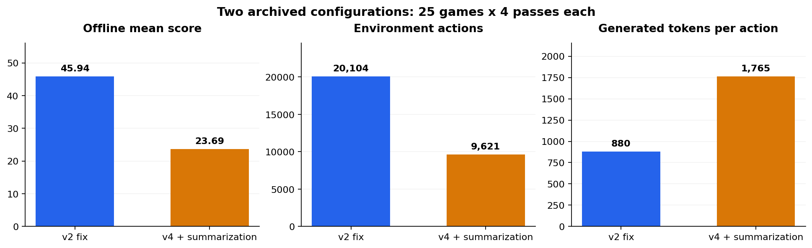
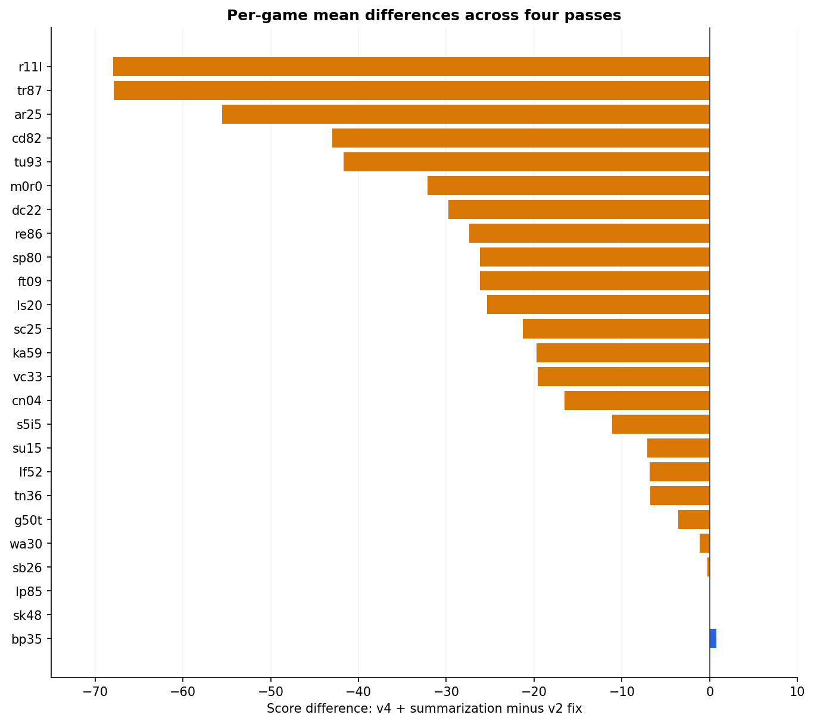
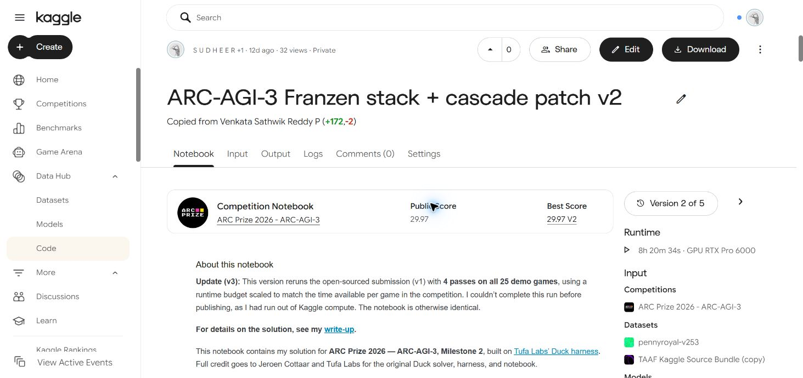

# Useful Interaction Under a Fixed Compute Budget

## An Empirical and Lifecycle Analysis of a Duck-Based ARC-AGI-3 Agent

**Sudheer Kumar Gandiboyana**  
Independent engineering study · 19 October 2026 · Version 1.0

[PDF paper](paper.pdf) · [Reproduction instructions](REPRODUCIBILITY.md) · [Machine-readable evidence](paper_evidence.json) · [Computed results](paper_results.json)

### Abstract

Interactive reasoning agents must infer unfamiliar mechanics while allocating finite environment actions and inference time. This report studies an archived ARC-AGI-3 agent built on Tufa Labs' Duck/TAAF framework and Daniel Franzen's Milestone-2 serving and harness modifications. The work examines a custom action-replay cascade, context management, and two historical offline jobs comprising 200 game-pass runs across 25 public games. Reconstructing every logged score yields a maximum discrepancy below 0.005 points. The v2-fixed configuration averages 45.94 offline, while a combined shortest-sequence/summarization configuration averages 23.69: a game-paired difference of -22.24 points, with a descriptive bootstrap interval of [-30.41, -14.72]. Generated tokens per action increase from 880 to 1,765. A lifecycle argument and execution of the actual archived patch against a controlled interface show why successful-level replay remains unused under current-level-only resets. A separate test exposes lost callback metadata. Finally, the stronger run's completion-preserving score ceiling is 47.69, leaving only 1.75 points recoverable through efficiency improvements alone. These findings support prioritizing additional level completion and measured useful interaction. They do not isolate summarization's causal effect or establish hidden-set generalization.

**Keywords:** interactive reasoning; LLM agents; inference systems; prefix caching; context management; reproducible evaluation; ARC-AGI-3.

## 1. Introduction

An interactive reasoning agent has to decide both what to do and what to learn next. An action can reveal a rule, advance a plan, or consume scarce resources without doing either. ARC-AGI-3 makes this tradeoff explicit by presenting unfamiliar environments with undisclosed mechanics and goals, then measuring performance against human action baselines. Its public demonstration set supports development; sealed environments serve a different generalization purpose. [Benchmark paper](https://arxiv.org/abs/2603.24621)

This study concerns the archived **cascade-patch-v2** lineage of the author's competition work. It does not evaluate the later `arcduck2` rewrite in the same repository. The agent uses an existing pretrained model. No weight training or fine-tuning was performed for this analysis.

The notebook's **29.97 public score** was verified in Kaggle's signed-in interface on 19 October 2026. The scored page identifies **Version 2**, `scriptVersionId=356244130`. The notebook remains private; readers can inspect the included screenshots, while the offline analysis is independently reproducible from the released logs. A screenshot is documentary evidence of what the interface displayed, not a cryptographic attestation of server-side scoring.

The report makes four contributions:

1. A configuration and provenance audit that distinguishes inherited infrastructure from the custom cascade intervention.
2. A conditional proof of replay unreachability, backed by tests executing the unmodified archived patch.
3. A reproducible comparison of two historical configurations, including all per-run score reconstruction and game-level uncertainty.
4. A completion-preserving scoring bound that helps rank future optimization work.

The intended contribution is an engineering case study with executable evidence. A new foundation model, benchmark-leading method, and isolated treatment effect are not claimed.

## 2. System and provenance

### 2.1 Inherited agent loop

Tufa Labs' Duck combines a model-facing Python tool with TAAF game execution. The agent inspects image and structured board representations, including ASCII and connected-component views, then invokes game actions from Python. This is an observation-and-action interface; it is not access to the hidden environment implementation. [Duck documentation](https://github.com/Tufalabs/duck-harness/blob/main/ARC3-Inference/README.md)

Franzen's extensions improve feedback, retained context, inference scheduling, and serving. They expose animation information and undo, preserve eligible model-written functions, and add guards around action sequences. These capabilities are inherited and are not attributed to this study. [Upstream write-up](https://github.com/da-fr/arc-agi-3-solution/blob/main/WRITEUP.md)

The notebook also credits the public cascade lineage from Venkata Sathwik Reddy P's notebook. The author's v2 work addresses reset tracking, failed-attempt caching, and enabled-action parsing. The released archived code is provided for audit, rather than as a claim that every component was authored independently.

### 2.2 Model and serving configuration

The model is Qwen3.8-Flash-Next. Its official description distinguishes the main sparse MoE backbone, activated parameters, n-gram embeddings, and MTP components. The architecture combines Gated DeltaNet with Qwen Sparse Attention and uses routed plus shared experts. Parameter totals and per-token active compute should therefore not be conflated. [Model card](https://huggingface.co/Qwen/Qwen3.8-Flash-Next)

Table 1 is reconstructed from the local notebook and the recorded launch commands. It is not inferred from current repository defaults.

| Component | Archived setting |
| --- | --- |
| GPU observed in logs | NVIDIA RTX PRO 6000 Blackwell Server Edition |
| Main checkpoint | Intel Qwen3.8-Flash-Next W4A16 AutoRound |
| Drafter | Albucino Flash-Next draft checkpoint |
| Serving lineage | Pennyroyal SGLang v2.5.3, commit `d00d88e` |
| Active inference streams | 10 |
| Harness context / output reserve | 131,072 / 12,288 tokens |
| Configured context drain | 59,392 tokens |
| Server context limit | 139,264 tokens |
| Attention KV / recurrent state | FP8 E4M3 / BF16 |
| Recurrent-cache slots | 60 |
| Chunked prefill | 8,192 tokens |
| Speculation | NEXTN, 3 steps, 4 draft tokens |
| Sampling | Temperature 0.7; top-p 0.95; top-k 20 |
| Reset policy | Current level only |

**Table 1.** Effective archived settings. Weight storage, attention cache, and recurrent-state cache consume different resources. W4A16 does not imply that all model components or cached state are four-bit.

Ten active inference streams should not be confused with the benchmark's 100 logical game-pass sessions. Admission control selects which histories obtain server capacity. Waiting sessions retain logical game state without all being simultaneously active requests.

### 2.3 Context is also a computational asset

Repeated agent requests share substantial conversation prefixes. SGLang's RadixAttention reuses shared-prefix KV computation. Prefix reuse can reduce repeated processing, but changing an early message can invalidate reuse for subsequent retained content. [SGLang paper](https://arxiv.org/abs/2312.07104)

The archived configuration preserves thinking history and evicts older history in blocks. A summary can reduce prompt length while adding generation cost, discarding evidence, and changing the cached prefix. Thus, memory compression must be evaluated end to end. The hybrid backbone additionally needs compatible recurrent checkpoints; attention KV capacity alone is not sufficient.

## 3. Research questions and method

The analysis asks: **RQ1**, can successful-level replay execute under the configured lifecycle? **RQ2**, does wrapping the action callback preserve metadata used by other components? **RQ3**, how do the two archived configurations differ? **RQ4**, how much score could perfect efficiency recover without additional completion?

### 3.1 Artifacts and observation unit

Two raw logs are released unchanged, with SHA-256 hashes: `v2fix_offline_2026-10-08.log` and `v4sum_offline_2026-10-09.log`. Each contains 25 public games with four game-pass records per game. The observation unit is a game-pass run; per-game means form the paired comparison. Results average all four passes and are not best-of-four scores.

The two serving command lines match. Job starts occur on different dates, so hardware contention and other job-level factors are not controlled. The later configuration combines a shortest-successful-sequence update with rolling summarization. It is not a summarization-only ablation.

The downloaded v2 notebook is separately fingerprinted. Its content has 25 cells, including a separate custom cascade cell at zero-based index 18. The screenshot does not authenticate the byte identity of that download to Kaggle's stored version; the manifest keeps those provenance claims separate.

### 3.2 Score reconstruction

For completed level k with human baseline h_k and agent actions a_k, the tagged runtime implementation calculates:

$$q_k=\min\left(115,100\left(\frac{h_k}{a_k}\right)^2\right).$$

An uncompleted level contributes zero. With positive level-index weights w_k=k, the environment score is:

$$S=\min\left(\frac{\sum_k w_kq_k}{\sum_k w_k},100\frac{\sum_{k:q_k>0}w_k}{\sum_k w_k}\right).$$

The 115 cap applies after squaring. The second cap prevents extra efficiency on solved levels from buying credit for unsolved levels. The analysis follows the versioned implementation, rather than assuming an equation in a prose description exactly matches executable behavior. [Tagged scorer](https://github.com/arcprize/ARC-AGI/blob/v0.9.9/arc_agi/scorecard.py#L135)

`reproduce.py` reconstructs every logged score from the level records, verifies the log hashes, and checks the expected aggregate counts. No model server or network is required.

### 3.3 Paired analysis

For each game g, the difference is its treatment mean minus its control mean. The aggregate statistic is the mean of the 25 differences. The archived analysis uses 20,000 game-bootstrap samples and a NumPy random generator initialized with seed 20261012.

The bootstrap interval describes variation under resampling these observed game differences. It is not a causal confidence interval for summarization or a guarantee of performance on a sealed, harder game distribution. Four passes per game also do not equal four independently repeated whole GPU jobs.

## 4. Lifecycle analysis and executable proofs

### 4.1 Proposition: successful-level replay is unreachable

**Assumptions.** A session moves through levels in increasing order. Completion of level k advances to k+1. Resets restart only the current level. Successful sequences are cached only after completion. Replay looks up a cached solution for the current level. The cache starts empty and is not shared between sessions.

**Proposition 1.** Under these assumptions, the successful-level replay branch cannot be entered.

**Proof.** Before completing level k, its successful-sequence entry is absent. At completion, the entry for k is created and the environment advances to k+1. Subsequent resets do not return to k. Therefore, whenever level k is current its successful entry is absent, and whenever its successful entry exists level k is no longer current. The replay condition requires both simultaneously, which is impossible. The argument applies inductively to every level. QED.

This proposition concerns this cache definition and lifecycle. It does not apply to a cache of safe prefixes within the current level, a system that revisits solved levels, or a cache deliberately shared across equivalent sessions.

**Executable check.** The reproduction script loads the unmodified `archived_cascade_v2.py` against an explicit fake runtime. It executes a failure/reset, a two-action completion containing undo, another failure/reset, and another completion. The patch caches successful sequences for levels 1 and 2, yet all five turns call the model path and zero return through replay. The test also confirms that undo is retained and the failed attempt is excluded.

### 4.2 Callback metadata

The archived wrapper replaces a bound `step_env` method with a plain closure. A Python bound method exposes its owner through `__self__`; a plain function does not automatically inherit this attribute. The downstream level-count lookup uses that owner.

The actual-patch test verifies both facts: the original callback has an owner, and the wrapped callback reaching the analyzer has none. Logs contain fallback-level-count warnings consistent with this discovery failure. Repeated warning lines are not counted as unique incidents. The measured score effect of repairing this metadata has not been established.

### 4.3 Proposition: completion-preserving score ceiling

Let C be the set of levels already completed in a run. Define the weighted completion ceiling:

$$U_C=100\frac{\sum_{k\in C}w_k}{\sum_k w_k}.$$

**Proposition 2.** If only action efficiency changes and the completed set C remains fixed, the environment score cannot exceed U_C.

**Proof.** The environment score is the minimum of the weighted efficiency term and the completed-weight cap. The latter depends only on C and the level weights. With C fixed, that cap remains U_C for every possible action count. Therefore S is at most U_C. With all completed levels receiving at least 100 efficiency points, the first term reaches or exceeds U_C, so the bound is attainable in the scoring formula. QED.

This is a scoring bound, not a claim that real trajectories can always be shortened to the necessary action counts. It does not bound search methods that change C or free sufficient compute to complete more levels.

## 5. Results

| Metric | v2 fix | v4 + summarization |
| --- | ---: | ---: |
| Game-pass records | 100 | 100 |
| Mean offline score | 45.94 | 23.69 |
| Completed game-pass runs | 31 | 12 |
| Completed levels, summed over passes | 401 | 257 |
| Environment actions | 20,104 | 9,621 |
| Generated tokens | 17,691,742 | 16,979,812 |
| Generated tokens per action | 880.01 | 1,764.87 |
| Completion-preserving ceiling | 47.69 | 24.20 |
| Benchmark duration | 8h 11m 5s | 8h 10m 56s |

**Table 2.** Archived outcomes. Durations exclude the earlier notebook setup. Counts sum all four passes, including repeated levels across independent game-pass sessions.

**Figure 1.** The combined later configuration generates approximately 4.0% fewer tokens while performing 52.1% fewer actions. Tokens per action roughly double. This is an accounting measure, not a measure of action quality.

The exact paired mean difference from rounded run scores is **-22.2442**. Its descriptive game-bootstrap 95% interval is **[-30.4109, -14.7241]**. Twenty-two game means decline, one improves, and two tie.

**Figure 2.** Four-pass means paired by game. Broad deterioration is visible across the demonstration set; the historical comparison still does not isolate a single causal feature.

All 200 logged scores reconstruct within 0.005 points, with maximum discrepancies of approximately 0.00473 and 0.00479 for the two logs. The margin is consistent with the logs rounding scores to two decimal places.

For the stronger run, U_C averaged over its runs is **47.68896**, while the observed mean is **45.93620**. The difference is **1.75276** points. Under unchanged completion, even perfect efficiency leaves the much larger uncompleted-weight gap untouched.

The later log contains summary attempts returning a Python tool request instead of the intended standalone text. Combined with almost unchanged token volume and sharply reduced interaction, this supports maintenance overhead and history replacement as plausible failure mechanisms. No direct measurement of every summary's cost or isolated summary intervention is available.

## 6. Related work and interpretation

Siriki's public report discusses solved-level memory, long context, precision settings, and experiments where jointly changing settings obscured the source of a regression. This supports testing evidence retention separately from advice and separating KV precision from weight conversion. Its reported gains belong to that author's system. [Siriki's write-up](https://github.com/LohitSiriki/arc-agi-3-milestone2-solution/blob/main/WRITEUP.md)

WorldCoder represents dynamics and rewards with Python programs revised from interaction, motivating a route from hypothesis testing to executable planning. Its experiments do not establish a gain for this ARC agent. [WorldCoder](https://arxiv.org/abs/2402.12275)

ARC-specific executable-model studies provide closer examples of model construction and replay verification. Their ablations show that requiring an executable representation is not uniformly beneficial, and more elaborate variants consume more resources. The verification treatment also changes interface structure, so its advantage is not a verification-only causal estimate. Public-set results and different model budgets limit direct transfer. [Initial study](https://arxiv.org/abs/2605.05138), [ablation study](https://arxiv.org/abs/2607.15439)

Speculative decoding offers a different optimization axis: reducing serial generation work through drafting and target verification. Its theoretical distribution-preserving formulation does not guarantee that a particular runtime, precision change, and concurrent workload preserve quality or improve throughput. [Speculative decoding](https://arxiv.org/abs/2211.17192)

The evidence here favors measuring useful work delivered to game sessions. It does not imply that more actions are always better. A policy producing many uninformative actions could worsen efficiency and completion simultaneously.

## 7. Proposed interventions

The following are research proposals, not demonstrated improvements:

**Clean control.** Remove the unreachable replay mechanism, retain the archived serving settings, and instrument per-level tokens, actions, completion events, context evictions, cached-prefix size, and admission delays. Preserve a source/configuration manifest for every run.

**Serving experiments.** Test optional dense-component FP8 conversion, concurrency, and speculative depth in separate stages. Pennyroyal documents specific precision-conversion results, but its current implementation differs from the pinned historical build. Validate that the selected path actually activates, then measure realistic long-history throughput, errors, memory residency, and game performance. [Pennyroyal FP8 notes](https://github.com/jpezzulli/sglang-rtxpro6000/blob/master/FP8.md)

**Evidence retention.** At history eviction, preserve a bounded trace of a solved level and the agent's existing note without generating a new summary. Updating the system prompt can still invalidate reuse of retained messages; this avoids an additional update event, not all prefill cost. Test later-level completion and cache cost together.

**Bounded executable mechanics.** Construct a small model of one uncertain interaction, verify on recorded and withheld observed transitions, and run bounded search only after those checks. Execute a short action prefix, compare prediction with observation, and replan on contradiction. A simulator fitting the observed history may still be wrong on unseen states.

**Search and allocation.** Backward search needs a known goal plus valid predecessor dynamics; undo does not prove reversibility. A new allocation policy should be compared with the inherited priority scheduler and charge for cache disruption. Job-ending censoring must not be treated as proof that an unfinished level is unsolvable.

## 8. Threats to validity

The two jobs are historical rather than randomized, isolated interventions. Configuration changes, contention, admission order, and stochastic sampling can affect results. Multiple sessions share a single GPU, creating interference. The public game set is small, repeatedly inspected, and easier than sealed evaluation sets.

The scorer validates numerical reconstruction from the released records; it does not independently validate the benchmark's human baselines or log authenticity. SHA-256 verifies artifact identity, not truthfulness. The tests use an explicit fake interface and exercise the archived patch, not the full GPU runtime. The lifecycle proof is conditional on its stated reset/session assumptions.

The 29.97 competition score and the offline 45.94 mean are different evaluations. The screenshots verify the displayed notebook version and public score, while the released logs support the offline calculations. No causal claim links the cascade fixes to the difference between historical leaderboard submissions. No later `arcduck2` sample metric is compared directly with RHAE here.

## 9. Reproducibility and artifact availability

Run `python reproduce.py` with Python 3.10+ and NumPy. The script checks raw-log hashes, reconstructs all 200 scores, regenerates game-paired statistics, and runs four checks including execution of the actual archived patch. It writes `paper_results.json` and `paper_verification.txt`.

The package includes raw logs, notebook/cell fingerprints, score/version screenshots, numerical results, figures, the archived custom patch, analysis code, a PDF builder, and checksums. Model weights, private evaluation data, and the large bundled third-party runtime are not redistributed.

Reproducing the analysis requires no GPU or network. Reproducing the original game-playing result would additionally require the exact checkpoints, offline dependencies, benchmark assets, and hardware. See [REPRODUCIBILITY.md](REPRODUCIBILITY.md) for the claim-to-artifact map.

## 10. Conclusion

This case study finds that an apparently useful replay optimization can be unreachable under the environment lifecycle, while a wrapper can preserve action execution yet break metadata-dependent scheduling. The historical combined context intervention produces substantially lower completion and twice the generated tokens per action. The scoring bound identifies additional level completion as the larger opportunity on the archived traces.

The next step is a controlled, instrumented comparison of one intervention at a time. Improving inference speed, memory, or planning should be judged by additional useful progress under the complete runtime budget.

## Acknowledgements and contributions

Tufa Labs and Jeroen Cottaar created Duck and TAAF. Daniel Franzen supplied the inherited Milestone-2 enhancements. Qwen, Intel, Albucino, John Pezzulli/Pennyroyal, and SGLang supplied model and serving components, with additional contributors credited upstream. The cascade notebook lineage also credits Venkata Sathwik Reddy P.

The author's work covered cascade bug fixes, engineering investigation, and experiment analysis. AI coding assistants supported implementation and preparation of this report; claims are tied to the released artifacts. Related authors' findings are identified as related work, and proposed improvements remain unmeasured.

## References

1. ARC Prize Foundation. *ARC-AGI-3: A New Challenge for Frontier Agentic Intelligence*. [arXiv:2603.24621](https://arxiv.org/abs/2603.24621).
2. ARC Prize Foundation. *ARC-AGI Toolkit, v0.9.9, scorecard.py*. [Versioned source](https://github.com/arcprize/ARC-AGI/blob/v0.9.9/arc_agi/scorecard.py).
3. Tufa Labs. *Duck harness*. [Repository](https://github.com/Tufalabs/duck-harness).
4. Daniel Franzen. *ARC-AGI-3 Milestone 2: Building on the Duck Harness*. [Write-up](https://github.com/da-fr/arc-agi-3-solution/blob/main/WRITEUP.md).
5. Qwen Team. *Qwen3.8-Flash-Next model card*. [Model documentation](https://huggingface.co/Qwen/Qwen3.8-Flash-Next).
6. Lianmin Zheng et al. *SGLang: Efficient Execution of Structured Language Model Programs*. [arXiv:2312.07104](https://arxiv.org/abs/2312.07104).
7. Yaniv Leviathan, Matan Kalman, and Yossi Matias. *Fast Inference from Transformers via Speculative Decoding*. [arXiv:2211.17192](https://arxiv.org/abs/2211.17192).
8. Hao Tang, Darren Key, and Kevin Ellis. *WorldCoder, a Model-Based LLM Agent*. [arXiv:2402.12275](https://arxiv.org/abs/2402.12275).
9. Sergey Rodionov. *Executable World Models for ARC-AGI-3 in the Era of Coding Agents*. [arXiv:2605.05138](https://arxiv.org/abs/2605.05138).
10. Sergey Rodionov. *Do Coding Agents Need Executable World Models, Simplification, and Verification to Solve ARC-AGI-3?* [arXiv:2607.15439](https://arxiv.org/abs/2607.15439).
11. Lohit Siriki. *Milestone-2 solution write-up*. [Source](https://github.com/LohitSiriki/arc-agi-3-milestone2-solution/blob/main/WRITEUP.md).
12. John Pezzulli/Pennyroyal. *Flash-Next FP8 documentation*. [Source](https://github.com/jpezzulli/sglang-rtxpro6000/blob/master/FP8.md).

## Appendix A. Score-display evidence

**Figure A1.** Read-only signed-in observation on 19 October 2026. The notebook title, Public Score 29.97, and Version 2 of 5 appear together. The exact version URL is recorded in the evidence manifest. Notebook privacy and screenshot limitations are described in Sections 1 and 8.
